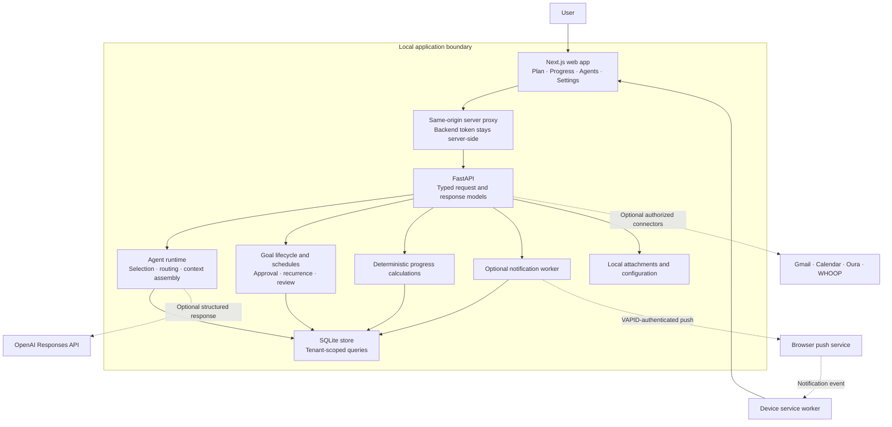
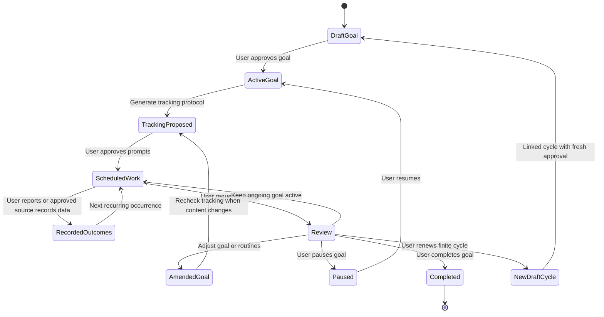
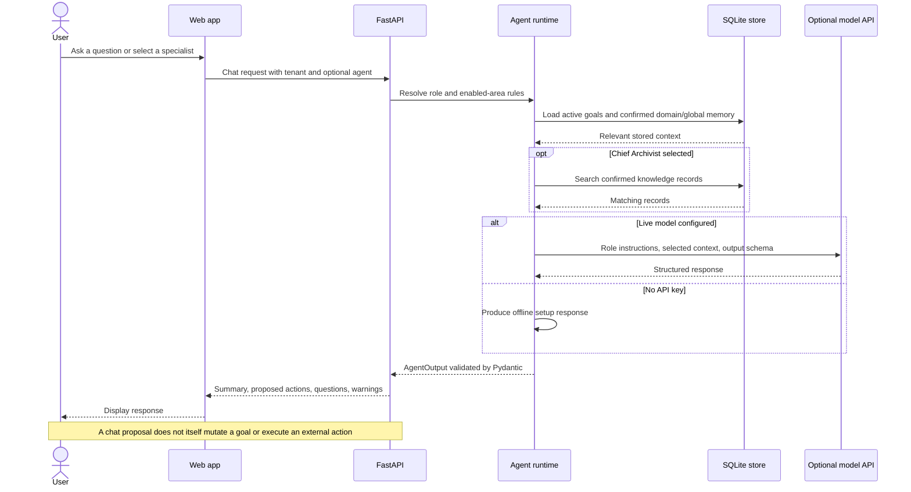
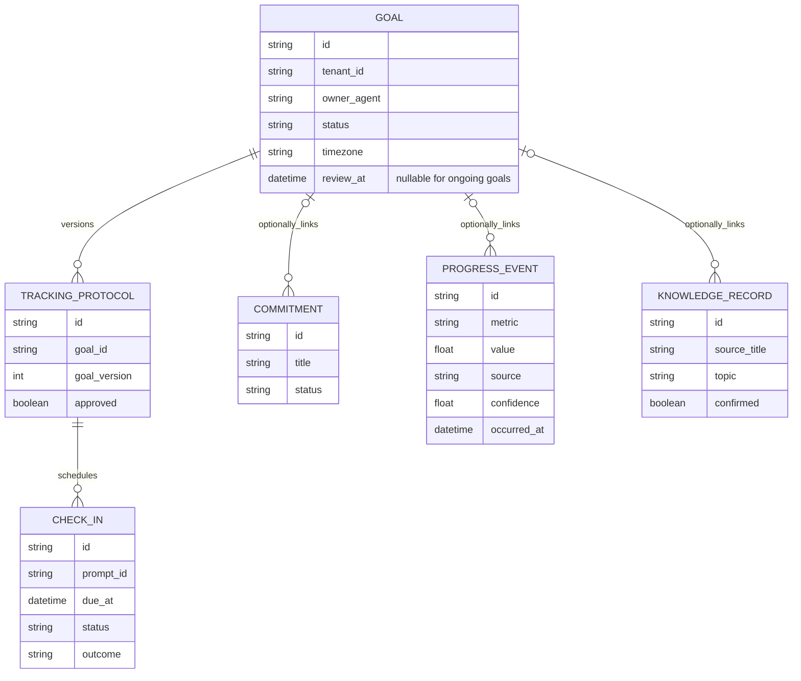
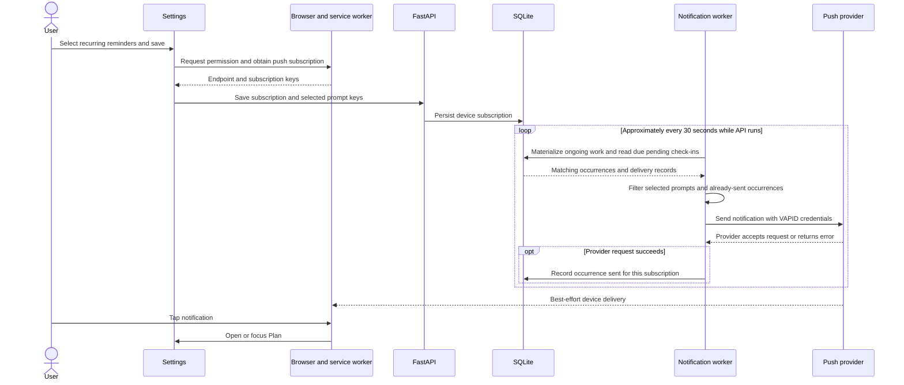

# Life OS — Community Edition

**A local personal operating system that turns goals into recurring commitments, records outcomes, and uses specialist AI agents for context and advice.**

Life OS explores a product question: **can one coherent operating loop reduce the work of coordinating goals, routines, reflection, and progress across life domains?** This repository is a working single-user prototype, not a production multi-user service or a claim of validated behavior change.

| At a glance | Implementation |
| --- | --- |
| Product surfaces | Plan, Progress, Agents, and Settings |
| Core stack | Next.js / React / TypeScript; FastAPI / Pydantic; SQLite |
| AI approach | Twelve defined roles; explicit agent selection or deterministic routing; optional OpenAI Responses API |
| Control model | User-approved goals and tracking protocols; software owns schedules and calculations |
| Local experience | Runs with synthetic demo goals and no API key; offline chat is a setup stub |
| Distribution | Standalone source with fresh history, generic examples, and an [MIT license](LICENSE) |

[Product intent](#product-intent) · [Architecture](#system-architecture) · [Requirements](#functional-requirements) · [Goal lifecycle](#goal-and-tracking-lifecycle) · [Agent flow](#agent-request-flow) · [Data model](#data-model-and-evidence) · [Notifications](#recurring-notification-flow) · [Tradeoffs](#technical-decisions-and-tradeoffs) · [Validation](#validation-and-success-measures) · [Local setup](#requirements)

## Product intent

### Problem and target user

A person managing several long-running priorities needs more than a list of tasks. Goals must become concrete routines; actions need evidence; missed work needs context; and useful learning should remain available for later decisions. Separate task, chat, journal, and dashboard tools can leave the user responsible for reconciling those records.

The primary user is an individual who wants one place to plan, record outcomes, and review priorities while retaining control over personal data and changes to their commitments. The secondary user is a developer or self-hosting evaluator who needs a runnable, inspectable implementation with optional integrations.

This is the product hypothesis and intended audience. The repository does not contain user-research results or adoption metrics.

### Goals and non-goals

| Product goals | Outside the current scope |
| --- | --- |
| Translate an approved goal into measurable routines and check-ins | Autonomous execution of arbitrary instructions from agent chat |
| Support ongoing goals without forcing artificial end dates | Fully automated weekly/monthly calendar reviews |
| Distinguish a planned action from a reported or imported outcome | Treating model-generated claims as verified progress |
| Retain relevant, explicitly confirmed memory | Unrestricted sharing of all personal context with every agent |
| Let the user choose recurring reminders and appearance | A managed push service or guaranteed notification delivery |
| Make the prototype runnable on a local machine | Public multi-user hosting, account management, or medical advice |

### Primary experience

1. **Define:** create a goal with an owner, success criteria, metrics, routines, and timezone.
2. **Approve:** approve the goal and separately approve its tracking prompts.
3. **Act:** use Plan to see check-ins and record an outcome or supporting information.
4. **Understand:** inspect Progress or ask a specialist for advice using relevant stored context.
5. **Review:** decide what to keep, amend, pause, or complete. Ongoing goals continue until the user changes them.

Goal creation and approval currently use the API documentation or Python examples. The web app focuses on execution, progress, and agent conversations; a complete goal-authoring UI is future work.

## System architecture

The local app separates the interface, model-based advice, and deterministic state management. Solid arrows represent application paths; dashed arrows represent optional external services.



**Important boundary:** tenant IDs scope records but do not authenticate people. The optional API token protects the backend interface; the web proxy is not a user-login system. Local servers bind to loopback by default. See [SECURITY.md](SECURITY.md) before considering a hosted deployment.

## Functional requirements

The table describes the community snapshot. “Implemented” identifies a code path, not a guarantee of production reliability.

| ID | User requirement | Current behavior / acceptance criterion | Status |
| --- | --- | --- | --- |
| FR-01 | Express a goal precisely | API accepts an owning specialist, success definition, exact metrics, routines, and timezone; `review_at: null` supports an ongoing goal | Implemented via API |
| FR-02 | Control what becomes scheduled work | Goal approval and tracking-protocol approval are separate steps; unapproved protocols do not materialize ongoing check-ins | Implemented |
| FR-03 | Keep recurring work available | Approved ongoing routines materialize in bounded windows beyond the original cycle; repeated reads do not duplicate the same prompt occurrence | Implemented |
| FR-04 | Record outcomes without losing context | Check-ins retain status and outcome; progress events record metric, unit, source, confidence, and occurrence time | Implemented |
| FR-05 | Ask the appropriate specialist | Explicit agent selection takes precedence; otherwise a keyword router selects a role, with a Chief of Staff fallback | Implemented |
| FR-06 | Keep durable knowledge under user control | Proposed knowledge records are excluded from confirmed search until the user confirms them; domain/global memory is filtered by tenant and expiry | Implemented |
| FR-07 | Choose reminders once | Settings lists approved recurring prompts, saves selections per device, and registers push after permission | Implemented; own keys and device permission required |
| FR-08 | Inspect progress without asking AI to calculate it | Backend summaries use stored commitments/events; the interface also aggregates scheduled check-ins and recorded metrics | Implemented |
| FR-09 | Review priorities without forced expiry | Ongoing review packets keep the goal active; finite cycles support review and renewal | Implemented via API; review meetings are manually scheduled |
| FR-10 | Try the system without sharing credentials | Three optional synthetic demo goals, an offline chat stub, and local storage support a first run without external accounts | Implemented |

## Goal and tracking lifecycle

A goal and its tracking protocol are separate objects. Approving an intention does not silently authorize every proposed reminder. The diagram focuses on the normal product flow; explicit status changes are available through the API.



For ongoing goals, recurrence follows the goal's configured wall clock, including daylight saving transitions. Schedule-only amendments preserve prompt identities and approval; content changes generate a new proposed protocol. Historical outcomes remain separate from new scheduled occurrences. A finite goal's review date is a cycle boundary, not an expiry rule applied to every recurring goal.

**Calendar recurrence semantics:** the first monthly, quarterly, or yearly check-in remains one day before the end of the first interval, capped by the review date for a finite cycle. Every later occurrence is calculated from that original first due date, with a clamp only in months where its day does not exist. For example, a January 1 start gives January 31 → February 28 → March 31; a December 31 start gives January 30 → February 28 → March 30. This preserves the existing first-due convention rather than silently changing it to the goal's start day. Existing materialized check-ins are not automatically rewritten by this scheduling fix.

Implementation: [goal models](src/life_os/models.py), [lifecycle engine](src/life_os/lifecycle.py), [store](src/life_os/store.py), [ongoing-goal tests](tests/test_ongoing_goals.py), and [calendar-recurrence tests](tests/test_calendar_recurrence.py).

## Agent request flow

The organization metaphor defines responsibilities; it does **not** imply twelve independent background agents continuously collaborating. The current runtime invokes one selected role per chat request. Routing is a transparent keyword heuristic, not a learned planner. General chat does not have durable conversation-history retrieval in this snapshot.



| Role group | Responsibility |
| --- | --- |
| Chief of Staff | Default coordination role and fallback for unmatched or disabled-domain requests |
| Eight specialists | Career, Knowledge, Briefing, Nutrition, Fitness, Inner Wellbeing, Operations, and Finance |
| Accountability Manager | Advice about commitments, blockers, and follow-through |
| Progress Tracker | Explanations informed by deterministic application summaries |
| Chief Archivist | Confirmed memory and source-specific knowledge recall |

Structured model output is validated, but schema validation does not establish factual truth. External actions remain separate connector/API operations. Live model requests set `store: false`; that flag is not a claim of zero provider-side retention under every account policy.

Implementation: [role definitions](src/life_os/agent_catalog.py), [routing and context](src/life_os/orchestrator.py), and [model client / offline stub](src/life_os/llm.py).

## Data model and evidence

The following is a **logical model**, not a claim that every relationship is a SQL foreign-key constraint. Several entities are stored as validated JSON payloads alongside queryable columns. Each record is scoped to a tenant namespace.



**Evidence rule:** a scheduled check-in is an intention; a recorded response or event is an outcome. The system stores provenance and confidence rather than silently equating a suggestion with completion. It can accept user-confirmed and imported measurements, but it does not independently prove every reported action occurred. Confirmed memory and knowledge records support later advice; they are not interchangeable with progress measurements.

## Recurring notification flow

Reminder preferences reference a goal and prompt, so choosing a recurring reminder applies to its later scheduled occurrences. The notification worker runs inside the API process when VAPID keys are configured.



The sent record prevents routine resend after a successful provider request; it is **not** proof of delivery or a transactional exactly-once guarantee. The worker uses a short due window, so it is not a durable outage-recovery queue. Stopping the API stops reminders. HTTPS, device support, permission, and the user's own keys are prerequisites for phone delivery.

Implementation: [notification worker](src/life_os/notifications.py), [notification tests](tests/test_notifications.py), and [service worker](mobile/public/sw.js).

## Technical decisions and tradeoffs

| Decision | Product / engineering rationale | Cost or limitation |
| --- | --- | --- |
| Local FastAPI + SQLite | Low setup overhead, inspectable persistence, and useful deterministic behavior without AI access | No managed availability, built-in database encryption, or production account model |
| Same-origin web proxy | One browser API surface; backend credentials need not be exposed as public frontend variables | Proxy access still needs authentication before internet hosting |
| Typed contracts and deterministic services | Scheduling, validation, and arithmetic remain testable independently of model responses | More explicit domain modeling; these services do not resolve every real-world ambiguity |
| Explicit role selection plus keyword routing | Predictable behavior with a simple fallback and clear debugging path | Vocabulary-sensitive routing; no sophisticated planning or multi-agent handoff engine |
| Separate goals, protocols, and outcomes | Users can approve what is tracked without rewriting evidence of past actions | Additional lifecycle steps and a larger data model |
| Bounded schedule materialization | Ongoing routines can continue without generating infinite rows | Calendar views and the worker must materialize the relevant time windows |
| In-process push worker | Small deployment footprint for a local prototype | Process uptime, retries, and provider/device behavior limit reliability |
| User-confirmed memory | Makes durable context explicit and inspectable | Confirmation creates friction; semantic recall and retention governance remain areas to improve |

## Validation and success measures

**Verified for the initial community release:** 62 backend tests passed, the Next.js production build completed, the synthetic local demo loaded in a browser, and a Gitleaks scan of the fresh publication history reported zero findings. These are engineering checks, not evidence of user adoption or improved personal outcomes. The tests do not constitute a complete security audit or an end-to-end phone-push certification.

| Validation area | Evidence / coverage |
| --- | --- |
| Goal continuity | Ongoing conversion, persistence, recurring check-ins beyond a cycle, history preservation, and daylight saving behavior |
| Data boundaries | Tenant-scoped store and API tests, confirmed-memory behavior, and redacted connector metadata |
| UI portability | Standard Next.js build and a synthetic demo without the original hosting platform |
| Publication privacy | Fresh history, ignored runtime files, generic examples, identifier review, and credential scanning |

For a pilot, the following would be **proposed measures, not current results**:

- **Activation:** proportion of new users who approve a goal and tracking protocol, then record one outcome within seven days.
- **Sustained usefulness:** weekly users who record outcomes and return for a review; completion rate alone should not reward trivial or excessive tasks.
- **Planning quality:** user-rated relevance of suggested next actions and frequency of corrections to routing or context.
- **Reliability:** duplicate scheduled occurrences, failed materialization requests, notification-provider failures, and device-confirmed delivery where measurable.
- **Trust guardrails:** unintended external actions, cross-tenant access failures, unconfirmed-memory retrieval, and secret-exposure findings.

No numerical adoption or latency targets are asserted before a baseline exists. For correctness regressions such as cross-tenant access or duplicate prompt occurrences, the acceptance expectation is zero failures in the relevant test suite.

### Next product increments

1. **Complete goal authoring:** create, negotiate, approve, and amend goals in the web interface; validate comprehension and setup completion with users.
2. **Improve coordination:** durable conversation context, more robust intent routing, and explicit specialist handoffs with traceable inputs.
3. **Strengthen operations:** durable job scheduling, bounded retry/backoff, delivery observability, and recovery after downtime.
4. **Support safe hosting:** authenticated identities, authorization checks, per-user credential storage, backups, and a reviewed deployment model.
5. **Evaluate the product hypothesis:** conduct a small longitudinal pilot before claiming behavioral or productivity impact.

These are future requirements, not promises that the current code already meets them.

---

## Run locally

An initial install starts empty. The optional demo creates three synthetic goals so you can try the interface immediately. No existing cloud account, personal record, or credential is bundled.

## Requirements

- Python **3.11 or newer** (3.12 recommended), with `pip` and `venv`.
- Node.js **22.13 or newer**, with `npm`.
- Git and pnpm **11.25.0**. To install pnpm: `npm install --global pnpm@11.25.0`.
- Internet for the initial dependency installation. After that, the demo and deterministic tracking work locally; AI calls and connected services need internet.

## Quick start — macOS / Linux

### 1. Clone and install the backend

```bash
git clone https://github.com/pujagorai9/life-os-community.git
cd life-os-community
python3 -m venv .venv
source .venv/bin/activate
python -m pip install -e '.[dev]'
cp .env.example .env
python scripts/bootstrap_private.py
```

No API key is needed for the first run. By default, `.env` stores the database at `private/life_os.db`. Your local data, attachments, profiles, and credentials are ignored by Git.

### 2. Optional: add synthetic demo goals

```bash
python scripts/seed_demo.py
```

This creates recurring learning, movement, and planning examples for tenant `me`. Running it again does not duplicate those goals. Skip this step if you prefer an empty database.

### 3. Start the API

From the repository root, with the virtual environment active:

```bash
life-os serve
```

Keep this terminal open. The API listens on **http://127.0.0.1:8000**.

- Health: http://127.0.0.1:8000/health
- Interactive API documentation: http://127.0.0.1:8000/docs

### 4. Start the web app in a second terminal

```bash
cd life-os-community/mobile
cp .env.example .env.local
pnpm install --frozen-lockfile
pnpm dev
```

Open **http://127.0.0.1:3000**. Both servers bind to loopback by default. Stop each with `Ctrl+C`.

## Windows / PowerShell

```powershell
git clone https://github.com/pujagorai9/life-os-community.git
cd life-os-community
py -3 -m venv .venv
.\.venv\Scripts\python.exe -m pip install -e ".[dev]"
Copy-Item .env.example .env
.\.venv\Scripts\python.exe scripts\bootstrap_private.py
.\.venv\Scripts\python.exe scripts\seed_demo.py
.\.venv\Scripts\life-os.exe serve
```

In a second PowerShell terminal:

```powershell
cd life-os-community\mobile
Copy-Item .env.example .env.local
pnpm install --frozen-lockfile
pnpm dev
```

Using the virtual environment executables directly avoids changing PowerShell's script execution policy. Windows instructions are provided for the same Python/Node commands; the release smoke test was run on macOS.

## Your own goals and configuration

Edit `private/profile.toml` to set a display name, timezone, enabled agents, and privacy preferences. Use an IANA timezone such as `Europe/London` or `America/New_York`; set the same `LIFE_OS_TIMEZONE` in `.env` before generating demo schedules.

The web app currently focuses on viewing and tracking goals. Use `/docs` for the goal-creation and approval workflow:

1. `POST /v1/goals` with a tenant, life domain, owning specialist, success definition, metrics, and routines. Set `review_at` to `null` for an ongoing goal; give it a `timezone`.
2. `POST /v1/goals/{id}/approve?tenant_id=me` to activate the goal.
3. Inspect `GET /v1/goals/{id}/tracking-protocol?tenant_id=me`.
4. `POST /v1/goals/{id}/tracking-protocol/approval` with `{"tenant_id":"me","approved":true}` to approve recurring prompts.
5. Refresh the web app. Record task outcomes and inspect Progress.

`scripts/seed_demo.py` is also a small, complete Python example of that lifecycle. For a different tenant, update `NEXT_PUBLIC_LIFE_OS_TENANT_ID` in `mobile/.env.local`; rebuild/restart the web app after changing public environment variables.

Review dates on finite goals are cycle boundaries. Ongoing goals have no expiry, and reviews do not automatically pause them. Schedule your own weekly/monthly review in a calendar; this public edition does not create meetings automatically.

## Optional live AI

Set these **in your local root `.env`**, using your own OpenAI API account:

```dotenv
OPENAI_API_KEY=your-own-api-key
LIFE_OS_MODEL=your-model-id
```

Choose a model available to your API project that supports Responses API structured outputs. Restart the API. Calls may incur usage charges. Keys stay on the backend; never use a `NEXT_PUBLIC_` variable for a secret.

Without an API key, chat is a deliberate offline stub, not an offline language model. Goal storage, demo data, check-ins, and progress calculations still work. No key is provided or shared by the repository.

## Optional recurring notifications

In **Settings → Notifications**, choose routines, then save and allow notifications. Each selected routine can notify at **each scheduled occurrence** while the API remains running. Preferences apply to the device/browser where you save them. Completed or skipped occurrences are not sent; this is not a repeated-nag system for one missed task.

Push delivery also needs your own VAPID public/private key pair in the root `.env`:

```dotenv
LIFE_OS_VAPID_PUBLIC_KEY=
LIFE_OS_VAPID_PRIVATE_KEY=
LIFE_OS_VAPID_SUBJECT=mailto:you@example.com
```

The public key is shared with the browser; the private key must remain secret. A blank pair leaves push delivery disabled. Use your push provider's VAPID key-generation instructions and restart the API after configuring the keys.

Desktop localhost supports service workers in supported browsers. Phone push requires your own **HTTPS** origin; `127.0.0.1` on a phone refers to the phone, not your computer. On iPhone, install the HTTPS site as a Home Screen web app and enable notifications from that app. This repository does not provision a public URL, certificates, or a push service for you. Keep the backend running for reminders.

## Optional integrations

The backend includes Google Gmail/Calendar and Oura/WHOOP connector code. Each user must register their own OAuth application, configure callback URLs, and consent to the required scopes. Google dependencies are optional:

```bash
python -m pip install -e '.[google-calendar,google-gmail]'
life-os --help
```

Leave these unset for local demo use. There are no connected accounts, scheduled email-processing jobs, private profiles, or wearable tokens included. The UI may show an integration as unavailable until you configure it.

## Local privacy and access

- Data is stored in `private/` and local SQLite/attachment files, not in GitHub.
- API keys and OAuth tokens belong in ignored local files or your own secret manager.
- With live AI or integrations enabled, the relevant content is sent to the configured provider. “Local” does not mean those optional API calls stay on your computer.
- This is a **single-user local application**, not an authenticated multi-user hosting service. A tenant ID is a data namespace, not an authentication boundary.
- Do not expose ports 3000 or 8000 to the internet without adding an authenticated access layer. The web proxy can add the API token; an API token alone does not authenticate users of the web app.
- To set an API token locally, put the same randomly generated `LIFE_OS_API_TOKEN` in root `.env` and `mobile/.env.local`, then restart both servers. `/health` remains public; `/docs` is a schema UI, not a login page. Supply `Authorization: Bearer <your-token>` for protected API requests.
- To reset local data, stop both servers and remove your configured SQLite database and its attachments. Back up anything you want to keep first.

## Build and test

```bash
# Repository root, virtual environment active
python -m pytest -q
python scripts/check_public_tree.py

# Web app
cd mobile
pnpm typecheck
pnpm build
pnpm start
```

The web production server also binds to `127.0.0.1:3000` by default. Build and runtime require your own local environment values; no cloud-specific build tooling is needed.

## Troubleshooting

| Symptom | Check |
| --- | --- |
| “Local API is not responding” | Start `life-os serve` from the repository root; check `/health`; confirm `mobile/.env.local` points to port 8000. |
| Empty Plan | Seed the demo, choose today's date, or create and approve a goal plus its tracking protocol. |
| Chat asks for an API key | Expected without live AI configuration. Set both `OPENAI_API_KEY` and `LIFE_OS_MODEL`, then restart the backend. |
| 401 / unauthorized | Root and web `LIFE_OS_API_TOKEN` must match. Restart both processes after changing them. |
| Port already in use | Stop the previous process, or change `life-os serve --port 8001` and update `LIFE_OS_API_URL`. |
| No push notifications | Configure VAPID keys, allow device permission, select routines, and keep the API running. Phone access needs HTTPS. |
| Wrong reminder time | Set the goal's IANA timezone. Demo goals use `LIFE_OS_TIMEZONE`, defaulting to UTC. |
| `pnpm` or Python not found | Install the prerequisites above and reopen your terminal. |

## Contributing and security

Run the tests and public-tree check before submitting a change. Do not commit real profiles, screenshots of personal data, databases, tokens, or `.env` files. See [SECURITY.md](SECURITY.md) for the release's privacy boundary and reporting guidance.
